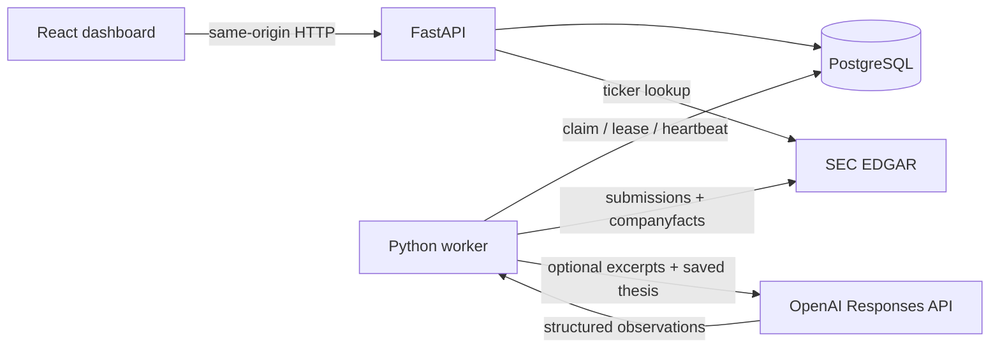

# Architecture

## Boundaries

The browser never calls SEC or the model provider. FastAPI validates inputs and writes versioned user decisions. A separate worker discovers filings, stores source snapshots, normalizes financials, and evaluates rules. PostgreSQL is both the system of record and durable queue. Nginx serves the production frontend and proxies `/api/` to FastAPI.

## Persistence

`companies` holds identifiers and freshness. `theses` and `rules` are immutable revisions; rule groups identify a sequence of versions. `snapshots` preserves source payloads by company/kind/content hash with source URLs and first retrieval time. `facts` preserves relevant raw source records by content hash. `observations` stores Decimal values alongside JSON provenance; an active flag identifies the current normalized view while older versions remain queryable in SQL. `filings` deduplicates accession numbers. `jobs` stores attempts, availability, ownership and lease expiry. `alerts` is unique on rule version plus observation identity; `alert_events` retains acknowledgment events. `analyses` references the exact thesis and filing versions, including model/prompt metadata and supplied excerpts.

## Financial correctness

Use dates and duration ranges, rather than trusting calendar-year or fiscal-period labels. Annual windows are 330–380 days; standalone quarter windows are 70–110 days. Derive Q2/Q3/Q4 by subtracting compatible YTD observations with the same start date, source tag, unit and known availability. Prefer a prior input from the same accession, otherwise the latest prior version available when the current source was filed. Preserve both inputs. Financial reclassifications can still require manual review; matching tags do not prove identical accounting basis.

Growth requires equivalent prior-year periods and the same source tags. Zero or negative prior values yield unavailable percentage growth; signed dollar changes remain inspectable through source values. Ratios and cash-flow differences require matching starts/ends. Missing inputs yield an explicit reason. Debt is an instant long-term-debt balance including current maturities where compatible total/components exist; it is not total liabilities or net debt.

Tag priorities are explicit in `backend/app/financials.py`. Current limitations and unsupported metrics are documented separately. Do not add custom concepts such as backlog to US-GAAP mappings without proving the issuer's disclosure supports them.

## Queue and concurrency

Enqueue acquires the company row lock, preventing simultaneous duplicate queued/running jobs of the same kind. Claim uses `FOR UPDATE SKIP LOCKED`; jobs at their attempt limit become failed. A worker holds a renewable lease; an abandoned lease can be reclaimed. All persistent ingestion/result writes verify current lease ownership. Lock order for processing is company, then job; heartbeats lock only the job. External network requests happen outside those transactions.

An hourly scheduler enqueues due refreshes. Retries use a bounded attempt count and exponential backoff. A refresh captures the submissions stage in its own transaction so filing discovery survives a later companyfacts failure. The previous good metrics stay available after failures. Discovery preceding facts is marked pending. The next refresh retries normalization.

Snapshot hashes, fact/observation identities, accession uniqueness, and alert uniqueness make replay safe. A crash after alert creation but before job success can re-run ingestion without duplicating the alert. Model results also record their originating job ID so replay does not insert the same result twice; the external model call can still repeat after a crash, incurring another charge. This is at-least-once execution, not exactly-once delivery.

## Rate limits and errors

A PostgreSQL advisory transaction lock and 300ms wait gates every SEC request start across API and worker processes in this deployment. It limits this application to fewer than four starts/second. Other apps sharing the same IP are outside its scope. HTTP requests also have bounded responses, fixed host/path construction, timeouts, and bounded transient retries. A long SEC Retry-After becomes a visible job failure/backoff rather than tying up a process indefinitely.

No automatic redirects are followed. Filing text is rendered as text. Mutating browser requests accept only known local origins, and HTTP Host validation prevents arbitrary hosts. These are useful local protections, not authentication.

## LLM boundary

The optional adapter uses the Responses API with a strict JSON schema, no tools, a bounded excerpt budget, and server-side credentials. HTML scripts/styles and hidden XBRL blocks are removed before text selection. Excerpts are deterministic windows around financial terms, with limited coverage explicitly disclosed. Model observations require exact normalized quotes present within one supplied excerpt. Quote validation proves textual support exists; it does not establish that the interpretation is correct or that all risks were considered. Source URL, excerpt hash/text, filing accession, thesis version, model, and prompt version are stored for review.

## Deliberate choices

- PostgreSQL queue rather than Redis/Celery: fewer services, clear durable state and explainable SQL locking; lower throughput and more responsibility for lease/retry code.
- Structured numeric rules: arithmetic is reproducible and testable; the LLM is reserved for narrative interpretation.
- Immutable versions: slightly more storage, much better explanations for historical alerts.
- One local user: faster path to a useful personal tool; public hosting needs authentication and isolation.
- In-app alerts first: no email credentials or message delivery side effects; unattended delivery is a future feature.
